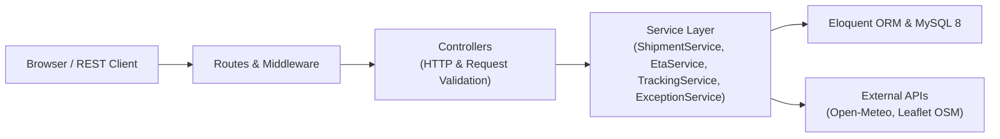
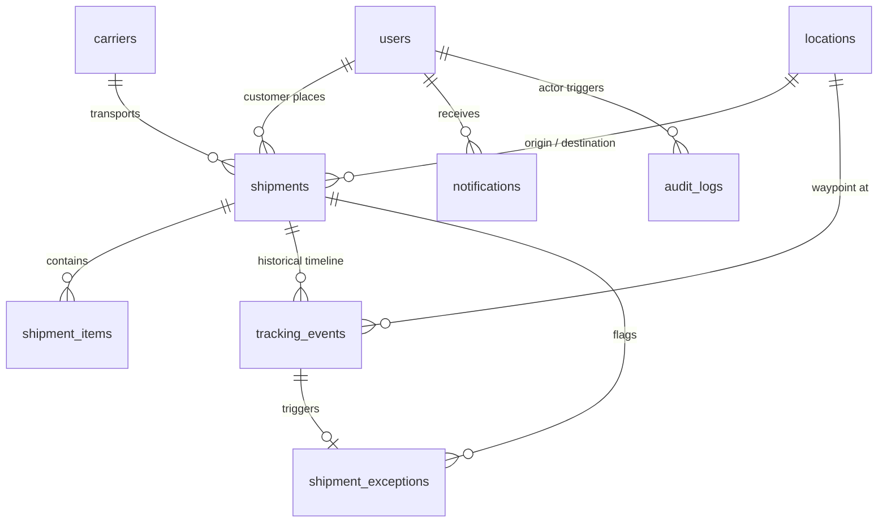

# CargoTrace - Global Shipment Visibility & Tracking Platform

> **Web Programming 2 • UAS Final Project**  
> *"Build a software portfolio project — not just a CRUD website."*  
> **Tech Stack:** Laravel 13, PHP 8.3+, MySQL 8+, Tailwind CSS, Leaflet.js (OpenStreetMap), Open-Meteo Weather API, PHPUnit.

---

## 1. Problem & Solution Overview

### The Problem
In modern international logistics, shipment milestones are often fragmented across disparate freight forwarder emails, proprietary carrier portals, and static spreadsheets. Customers suffer from lack of visibility into real-time journey progress and delay reasons. Meanwhile, logistics operators lack a unified console to detect delays deterministically, log operational exceptions (e.g. customs holds, port congestion), and trigger timely customer alerts.

### The CargoTrace Solution
**CargoTrace** is an enterprise-grade visibility and tracking platform providing end-to-end shipment lifecycle management:
- **State Machine Lifecycle:** Governs shipment status with strict backend transitions (`CREATED` &rarr; `BOOKED` &rarr; `PICKED_UP` &rarr; `IN_TRANSIT` &rarr; `DELIVERED`). Terminal status is strictly locked.
- **Append-Only Chronological Tracking:** Historical waypoints are preserved without overwriting historical records.
- **Deterministic Delay & ETA Engine:** Evaluates expected vs estimated arrival times and assigns severity (`LOW`, `MEDIUM`, `HIGH`) based on configurable thresholds.
- **Operational Exception Management:** Logs, investigates, and resolves anomalies (`CUSTOMS_HOLD`, `WEATHER_DELAY`, `PORT_CONGESTION`, etc.).
- **Interactive Geospatial Visualization:** Leaflet.js with OpenStreetMap renders origin, destination, intermediate tracking points, and voyage polylines with zero external proprietary map costs.
- **External Atmospheric Intelligence:** Integrates live port weather observations via Laravel HTTP Client with timeout resiliency.

---

## 2. Design System & Color Palette

CargoTrace uses a curated **Deep Navy & Warm Beige** corporate aesthetic:

| Token | Hex Code | Visual Application |
|---|---|---|
| **Deep Navy (Primary Dark)** | `#0A0F1D` / `#0F172A` | Top navigation bar, primary buttons, hero branding, table headers |
| **Warm Beige / Sand (Surface)** | `#FAF7F2` / `#F4EBD9` | Application background, secondary cards, form borders, badges |
| **Accent Brass / Gold** | `#D4AF37` / `#BD976C` | Active navigation highlights, destination map markers, notifications |
| **Status Emerald** | `#10B981` | Delivered status, on-time indicators, completed waypoints |
| **Status Amber / Rose** | `#F59E0B` / `#E11D48` | Operational exceptions, delay warnings, critical alert cards |

---

## 3. Architecture & Service Layer Guideline

In accordance with architectural requirements (Slide 15 of brief), HTTP controllers do not contain business logic. Business logic is strictly encapsulated in dedicated domain services:



### Domain Services Breakdown
1. **`ShipmentService`**: Handles shipment registration, unique identifier generation (`CT-YYYY-XXXX`), updates, and lifecycle state validation.
2. **`EtaService`**: Compares `expected_arrival_at` vs `estimated_arrival_at`, computes delay duration in hours, and classifies severity (`LOW`, `MEDIUM`, `HIGH`) against configurable group thresholds.
3. **`TrackingService`**: Records append-only historical tracking milestones, coordinates customer notifications, and logs audit entries.
4. **`ExceptionService`**: Handles raising and resolving operational disruptions, linking exceptions to tracking milestones.
5. **`WeatherService`**: Consumes external weather forecast endpoints with caching (`Cache::remember`), timeouts (5s), and graceful fallback.
6. **`AuditLogService`**: Maintains an immutable ledger of system actions, actors, IP addresses, and state diffs.

---

## 4. Entity-Relationship Data Model (ERD)

The database schema comprises **9 core tables** meeting the minimum data model specification:



### Table Cardinality & Design Rationales
- **`users`**: Manages accounts with role-based access (`admin`, `operator`, `customer`).
- **`carriers`**: Registry of maritime and air carriers (`MAEU`, `EMC`, `MSC`, `ONE`, `DHL`).
- **`locations`**: Geocoded UN/LOCODE sea ports, air hubs, and terminals with precise lat/long coordinates.
- **`shipments`**: Central order entity. Has foreign keys to `customer_id`, `carrier_id`, `origin_id`, `destination_id`.
- **`shipment_items`**: One-to-many relationship with `shipments`. Holds HS code, weight, volume, and quantity.
- **`tracking_events`**: Append-only log. Ordered chronologically by `event_time`. Never overwritten.
- **`shipment_exceptions`**: Tracks disruptions with resolution timestamps and assigned operator IDs.
- **`notifications`**: Targeted in-app alerts for milestone updates and exceptions.
- **`audit_logs`**: Security compliance trail storing serialized JSON before/after snapshots.

---

## 5. Role-Based Access Control (RBAC)

All endpoints and actions enforce strict server-side authorization via Laravel Policies and Middleware:

| Feature / Resource | Administrator | Logistics Operator | Customer |
|---|:---:|:---:|:---:|
| **Dashboard Metrics** | Full Global View | Operational Scope | Scoped to Own Shipments |
| **View Shipments** | All Shipments | All Shipments | Only Own Shipments |
| **Create / Update Shipment** | Allowed | Allowed | Denied (403) |
| **Transition Status** | Allowed | Allowed | Denied (403) |
| **Add Tracking Waypoint** | Allowed | Allowed | Denied (403) |
| **Raise / Resolve Exception** | Allowed | Allowed | Denied (403) |
| **Manage Carriers & Hubs** | Full Access | View Only | View Only |
| **System Audit Trail** | Full Access | Denied (403) | Denied (403) |

---

## 6. Pre-Configured Demo Accounts

Run `php artisan db:seed` to populate demonstrative accounts:

| Role | Email | Password | Scope |
|---|---|---|---|
| **Administrator** | `admin@cargotrace.com` | `password` | Complete system access & audit logs |
| **Logistics Operator** | `operator@cargotrace.com` | `password` | Shipment creation, tracking & exceptions |
| **Customer (Elena)** | `customer@globaltrade.com` | `password` | Owns `CT-2026-0001` (Delayed +28h in transit) |
| **Customer (Hiroshi)**| `customer@asiapacific.com` | `password` | Owns `CT-2026-0002` (Delivered terminal state) |

---

## 7. REST API Documentation

All API responses follow consistent JSON envelopes with standardized status codes (`200`, `201`, `401`, `403`, `404`, `422`).

A ready-to-import Postman Collection is provided at:  
`cargotrace_postman_collection.json`

### Core Endpoints:
- `POST /api/login` & `POST /api/register`
- `GET /api/user` (Bearer token required)
- `GET /api/shipments` (Supports `?status=IN_TRANSIT`, `?carrier_id=1`, `?search=solar`, `?per_page=15`)
- `POST /api/shipments` (Admin/Operator only)
- `GET /api/shipments/{id}`
- `POST /api/shipments/{id}/transition` (Advance lifecycle state)
- `GET /api/shipments/{id}/tracking` & `POST /api/shipments/{id}/tracking`
- `GET /api/shipments/{id}/exceptions` & `POST /api/shipments/{id}/exceptions`
- `PATCH /api/exceptions/{id}` (Resolve exception)
- `GET /api/carriers` & `GET /api/locations`

---

## 8. Installation & Setup Guide

### Prerequisites
- PHP 8.3+ with `pdo_mysql`, `pdo_sqlite`, `curl`, `mbstring` extensions enabled.
- Composer 2+
- Node.js 18+ & NPM
- MySQL 8.0+

### Step-by-Step Setup
```bash
# 1. Clone repository
git clone https://github.com/<your-username>/cargotrace.git
cd cargotrace

# 2. Install PHP and Node dependencies
composer install
npm install

# 3. Environment configuration
cp .env.example .env
php artisan key:generate

# 4. Run migrations and demo seeds
php artisan migrate --seed

# 5. Build frontend assets (Vite + Tailwind)
npm run build

# 6. Start development server
php artisan serve
```
Open your browser at `http://localhost:8000`.

---

## 9. Automated Testing & Verification

The test suite covers authentication, role authorization barriers, state machine invariants, and deterministic delay calculations using an in-memory SQLite database:

```bash
php artisan test
```

### Test Evidence Summary:
- `Tests\Feature\AuthenticationTest`: Valid login, invalid credentials rejection (401), unauthorized API blocking.
- `Tests\Feature\ShipmentManagementTest`: Admin/Operator CRUD, customer creation prevention (403), customer cross-tenant visibility blocking (403).
- `Tests\Feature\ShipmentLifecycleTest`: Valid step transitions (`CREATED` &rarr; `BOOKED` &rarr; `PICKED_UP` &rarr; `IN_TRANSIT` &rarr; `DELIVERED`), invalid status jumps rejected (422), terminal status lock verification.
- `Tests\Feature\EtaDelayTest`: Deterministic delay calculation against configurable thresholds (`LOW` &le; 6h, `MEDIUM` &le; 24h, `HIGH` > 24h).

---

## 10. Code Ownership & Oral Exam Defense Guide

Prepared specifically for the UAS Code Ownership Interview (Slide 19 & 20):

#### Q1: "Mengapa relasi antara Shipment dan TrackingEvent menggunakan hasMany?"
> **Answer:** "Sebuah shipment dalam perjalanan logistik melalui banyak titik transit fisik dan pencatatan status secara kronologis. Sesuai prinsip *append-only* (Slide 7 brief), event lama tidak boleh ditimpa saat status baru ditambahkan. Oleh karena itu, relasinya adalah `1 Shipment hasMany TrackingEvents`."

#### Q2: "Bagaimana cara sistem mencegah status invalid atau lompatan status?"
> **Answer:** "Di kelas `ShipmentService`, terdapat method `transitionStatus()`. Method ini memvalidasi transisi menggunakan konstanta `VALID_TRANSITIONS` di model `Shipment`. Jika status saat ini adalah `CREATED`, sistem hanya mengizinkan transisi ke `BOOKED`. Jika operator mencoba langsung ke `DELIVERED`, sistem melempar `InvalidArgumentException` dan mengembalikan respons HTTP `422 Unprocessable Entity`."

#### Q3: "Bagaimana cara mengubah threshold delay sesuai skenario kelompok?"
> **Answer:** "Threshold delay diisolasi secara deterministik di file `config/cargotrace.php` dan dapat disesuaikan melalui environment variable `.env`:
> ```env
> DELAY_THRESHOLD_LOW=12
> DELAY_THRESHOLD_MEDIUM=24
> GROUP_SCENARIO=\"Group B\"
> ```
> `EtaService` membaca config ini melalui `config('cargotrace.delay_thresholds')` sehingga threshold dapat diubah secara instan tanpa memodifikasi kode inti logika kalkulasi."

#### Q4: "Bagaimana jika service eksternal Open-Meteo atau OpenStreetMap mengalami downtime?"
> **Answer:** "Di `WeatherService`, pemanggilan API dibungkus dengan `Http::timeout(5)->get(...)` dan blok `try-catch`. Jika koneksi timeout atau error, sistem mencatat log dan mengembalikan struktur fallback `available: false` dengan pesan ramah pengguna tanpa memicu error 500. Untuk OpenStreetMap, Leaflet.js memuat tile secara asynchronous di sisi browser dengan fallback rendering."
